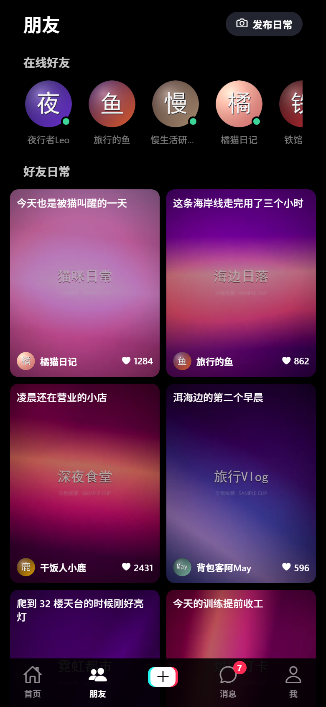
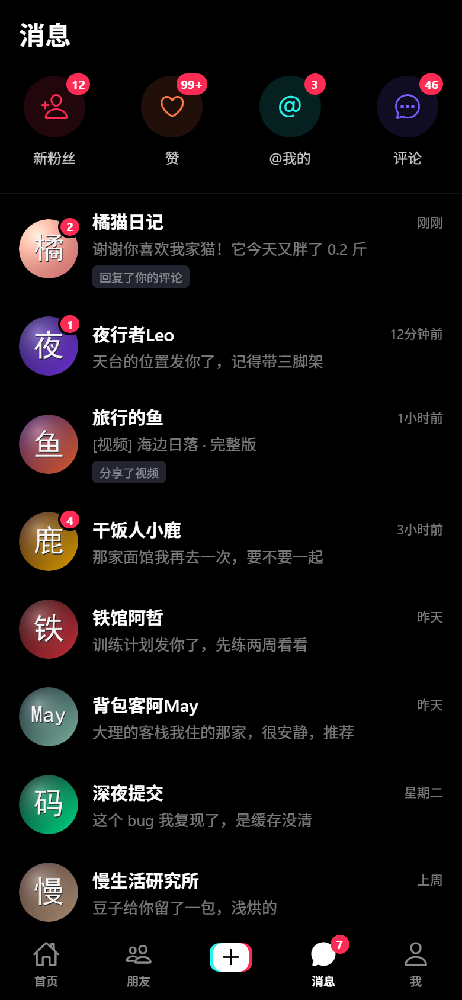
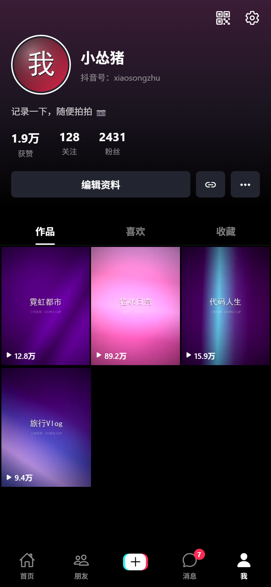
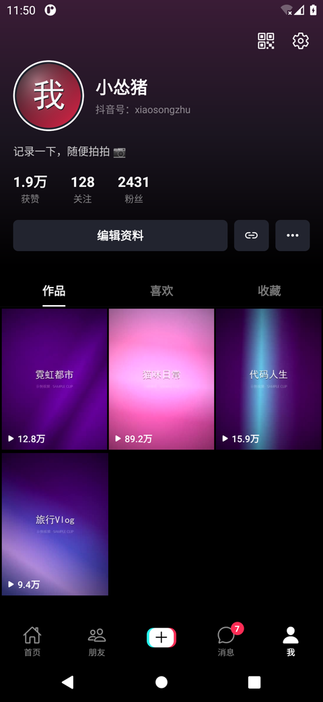

# 抖音 · Douyin Clone (Expo / React Native)

一个用 **Expo SDK 57 + React Native 0.86 + TypeScript** 写的仿抖音短视频 App。
竖向全屏视频流、双击点赞、评论面板、分享面板、消息中心、个人主页，全部跑在本地素材上，
**不依赖任何网络请求或第三方接口**。

> **直接装到手机体验** → [下载 v1.0.0 APK](https://github.com/aiyangdie/douyin-app/releases/latest)
> （82 MB，含 `arm64-v8a` / `armeabi-v7a` / `x86_64`，已在 Pixel 5 / Android 11 实机验证）

---

## 快速开始

```bash
cd douyin-app
npm install

npm run web        # 浏览器预览
npm run ios        # iOS 模拟器（需 macOS）
npm run android    # Android 模拟器 / 真机
```

也可以 `npx expo start` 后用 **Expo Go** 扫码在手机上直接打开 —— 用到的原生模块
（`expo-video`、`expo-blur`、`expo-haptics`、`expo-linear-gradient`、`async-storage`）
都在 Expo Go 的内置列表里，不需要 development build。

---

## 界面

以下截图全部来自真实运行的 App（Expo Web + Chrome DevTools Protocol 驱动，
390×844 @2x），不是设计稿。

| 首页视频流 | 双击点赞 | 评论面板 | 分享面板 |
|---|---|---|---|
|  |  |  |  |

| 滑动到下一条 | 朋友 | 消息 | 我 |
|---|---|---|---|
|  |  |  |  |

### Android 实机（release APK，Pixel 5 / Android 11）

| 视频流 | 评论面板 | 分享面板 | 个人主页 |
|---|---|---|---|
|  |  |  |  |

---

## 打包 Android APK

```bash
npx expo prebuild --platform android --no-install
cd android
./gradlew :app:assembleRelease -PreactNativeArchitectures=arm64-v8a,armeabi-v7a
# -> android/app/build/outputs/apk/release/app-release.apk
```

`app.json` 里的 `com.example.douyinapp` 是脚手架占位包名。侧载到自己的手机没问题，
但 **Google Play 会拒绝 `com.example.*`**，而且包名一经发布不可更改 —— 上架前先改成
你自己的域名倒写。

release 构建默认用仓库里的 debug keystore 签名（Expo 模板行为），所以能直接安装；
要上架则需换成自己的签名密钥，并妥善保管 —— 丢了就无法再更新同一个应用。

---

## 功能

### 首页视频流
- 竖向全屏分页，一次一条，滑动吸附（`FlatList` + `pagingEnabled` + `snapToInterval`）
- **单击暂停/继续**，**双击点赞**并弹出大爱心动画 —— 与抖音一致：单击动作会延迟
  280ms，若期间来了第二下就取消暂停、改为点赞
- 底部播放进度条由 `timeUpdate` 事件直接写入 `Animated.Value`，**不触发 React 重渲染**
- 视频加载完成前显示缩略图占位，加载完成后淡出

### 性能
只有**当前页和相邻页**挂载播放器（`shouldMountPlayer`），其余页面只渲染缩略图与
UI 覆盖层。列表本身用 `windowSize={3}` + `removeClippedSubviews` 限制挂载范围。

### 右侧操作栏
头像 + 关注按钮、点赞、评论、收藏、分享、旋转唱片。每个按钮都有按压缩放动画，
爱心变红、收藏变琥珀色。

### 评论面板
作者置顶标记、嵌套回复折叠、评论点赞、输入框可真实发表评论（本地追加），
头部显示该视频的真实评论总数。

### 分享面板
8 个分享目标（微信/朋友圈/QQ/微博/复制链接/保存本地/私信/更多）+ 4 个操作
（收藏/举报/不感兴趣/减少相似），点击后弹出 1.4 秒浮层提示。

### 其他页面
- **朋友** —— 在线好友横滑 + 双列错落「日常」瀑布流
- **消息** —— 新粉丝/赞/@我的/评论 四个快捷入口 + 会话列表（未读角标）
- **我** —— 渐变封面、头像、数据统计、作品/喜欢/收藏三个分栏与九宫格

### 状态持久化
点赞、收藏、关注、评论点赞、静音偏好通过 `zustand` + `AsyncStorage` 持久化，
重启 App 后保留。

---

## 项目结构

```
douyin-app/
├── src/
│   ├── app/                      # Expo Router 路由树（约定：路由只能放这里）
│   │   ├── _layout.tsx           # 根布局：SafeAreaProvider + Stack + 两个底部面板
│   │   └── (tabs)/
│   │       ├── _layout.tsx       # 底部 Tab 导航（自定义 tabBar）
│   │       ├── index.tsx         # 首页 · 视频流
│   │       ├── friends.tsx       # 朋友
│   │       ├── inbox.tsx         # 消息
│   │       └── me.tsx            # 我
│   ├── components/
│   │   ├── feed/                 # VideoFeed / VideoPage / VideoLayer / ActionRail …
│   │   ├── overlays/             # CommentsSheet / ShareSheet
│   │   ├── tabs/                 # DouyinTabBar（含红青错位的「+」按钮）
│   │   └── ui/                   # Avatar / BottomSheet / Marquee
│   ├── data/                     # 类型与模拟数据（创作者、视频、评论、会话）
│   ├── lib/                      # format / useAnimatedValue / useTabBarHeight
│   ├── store/                    # zustand 全局状态
│   └── theme/                    # 设计变量与公共样式
├── assets/
│   ├── videos/                   # 8 条本地竖屏视频（约 2.5 MB）
│   ├── avatars/                  # 9 张渐变头像
│   └── thumbs/                   # 8 张视频封面
└── tools/                        # 素材生成 + Web 验证工具（见 tools/README.md）
```

---

## 素材

所有视频和图片都是**本地生成**的，无下载、无版权问题：

- `tools/gen_videos.py` —— 用 ffmpeg 的 `lavfi` 源合成 8 条 720×1280 / 8 秒 /
  H.264 + AAC 的渐变短片，叠加热点光晕与黑体标题
- `tools/gen_images.py` —— 用 Pillow 画渐变头像，并从视频抽帧生成封面

```bash
python tools/gen_videos.py
python tools/gen_images.py
```

需要 `ffmpeg` 在 `PATH` 上，以及带 `numpy` + `Pillow` 的 Python。

---

## 验证

```bash
npx tsc --noEmit     # 类型检查：0 错误
npx eslint .         # ESLint：0 问题
npx expo-doctor      # 依赖与配置诊断
```

Web 端用 CDP 做了实机截图验证（`tools/shoot.mjs`，零依赖），覆盖了视频播放
（`currentTime` 推进）、滑动切页、双击点赞、评论发表、分享浮层、四个 Tab 切换，
页面错误数为 **0**。

---

## 实现中值得一提的几个坑

这些都是实际调试出来的，不是凭记忆写的：

1. **`expo-router` 的 `Tabs` 在 SDK 57 已废弃**，要从 `expo-router/js-tabs` 导入。
   项目里用的是 `expo-router@57.0.25`。
2. **SDK 57 不再内置 `@expo/vector-icons`**，需要显式安装，并且它还需要 `expo-font`
   作为 peer dependency（缺了 `expo-doctor` 会报，且脱离 Expo Go 会崩溃）。
3. **`StyleSheet.absoluteFillObject` 在 RN 0.86 已被移除**，只剩 `absoluteFill`，
   且它现在直接就是样式对象（不再是注册 ID），可以展开。
4. **`<video>` / `` 是替换元素**：`position:absolute; inset:0` 配 `width:auto`
   时它们按固有像素尺寸布局并忽略 inset 约束 —— 720×1280 的视频会在 390×844 的
   屏幕里按原尺寸渲染再被裁掉。必须显式给 `width/height: 100%`（见 `theme/styles.ts`
   的 `FILL`）。
5. **底部面板必须渲染在导航器之上**。放在 Tab 屏幕内部时 z 序低于悬浮 Tab 栏，
   输入框和「取消」按钮会被压住。
6. **`useRef(...).current` 在渲染期读取**会被 React Compiler 的 lint 规则拒绝；
   用 `useState(() => new Animated.Value(x))` 持有实例（见 `lib/useAnimatedValue.ts`）。
7. **`pagingEnabled` 在 Android 上不支持纵向分页**（React Native 明文写的限制）。
   它和 `snapToInterval` 同时设置时，Android 上每次拖动都会被吸回原来那一页 ——
   Web 端却正常，因为浏览器用的是原生滚动。只用 `snapToInterval` 即可两端都对。
8. **ffmpeg 的 `noise` 滤镜会把视频体积放大 250 倍** —— 每帧随机噪点几乎不可压缩，
   8 秒短片从 ~300 KB 变成 ~77 MB。
9. **Windows 下向 ffmpeg 传中文参数会被破坏**，且字体绝对路径的盘符冒号会被
   filtergraph 解析成选项分隔符 —— 改用 Python `subprocess` + 相对字体路径。

---

## 已知限制

- 发布、私信、搜索、直播等入口是 UI 占位，点击无跳转
- 分享和保存本地只弹提示，不调用系统分享面板（那是 `expo-sharing` 的活）
- 评论列表只渲染首页数据，头部显示的是完整总数（与真实信息流一致）
- Web 端为验证用途；浏览器自动播放策略下首次进入可能静音，可用右上角喇叭切换
