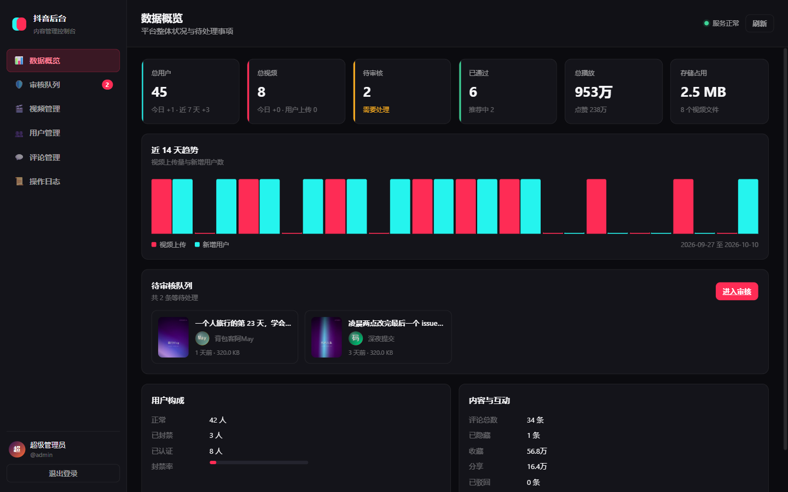
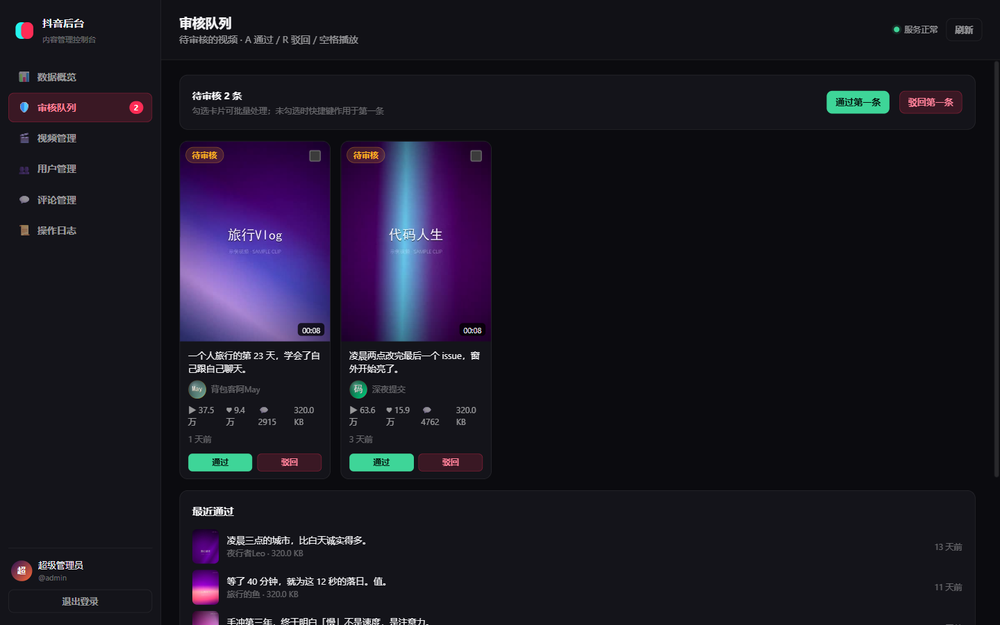
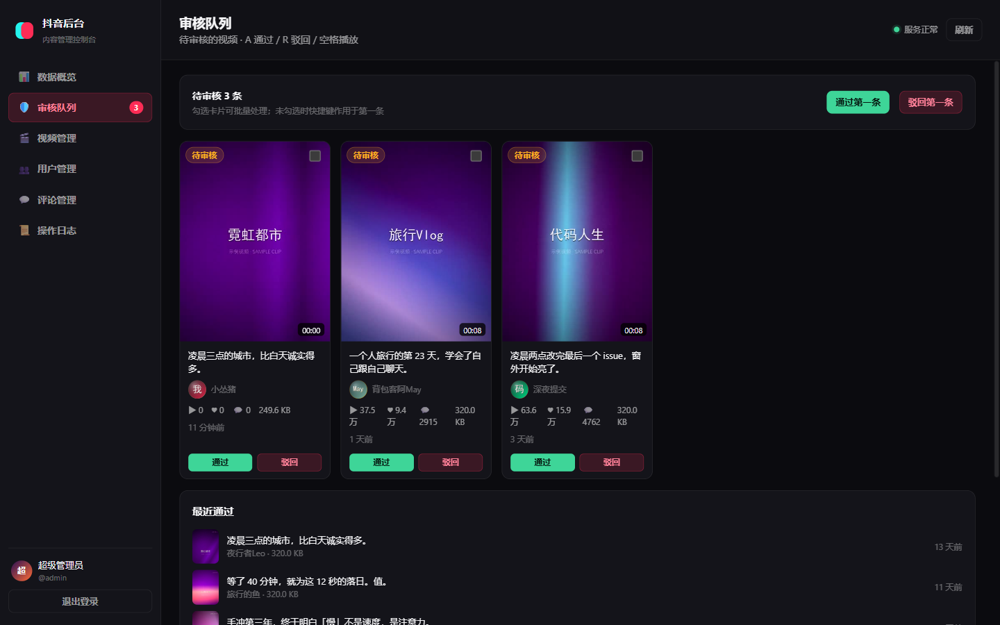
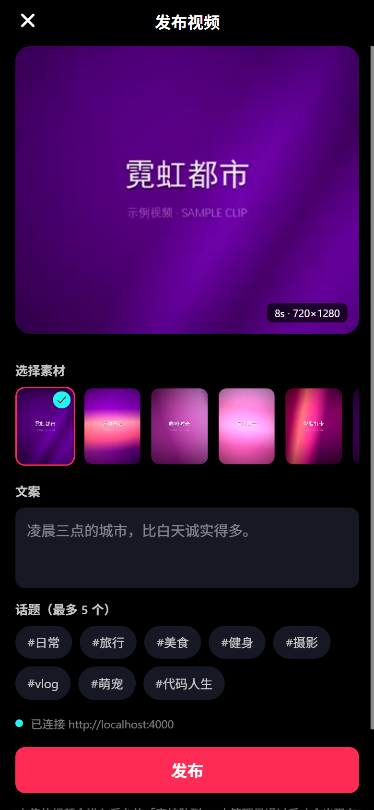
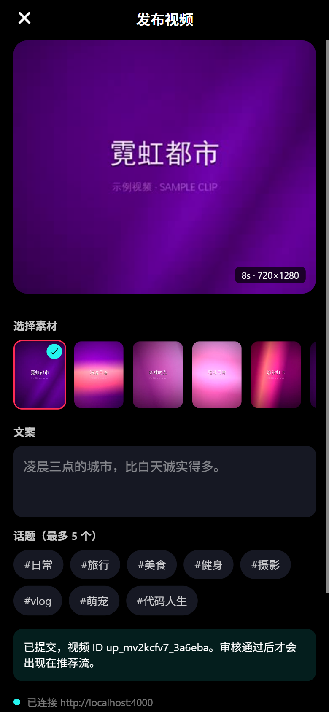

# 后台管理系统

给这个仿抖音 App 配的一套**内容管理后台**：查看用户、审核视频、管理评论、追踪操作日志。

---

## 为什么需要这一层

改造之前，这个 App **完全没有后端** —— 数据全是 `src/data/*.ts` 里的本地 fixture，
没有服务器、没有数据库、没有账号体系、也没有任何上传入口。

所以「后台查看用户、查看上传的视频」这件事的前提是：**先把这条链路建起来**。
这一层就是那条链路。

---

## 架构

```
┌──────────────┐   上传 / 拉取推荐流   ┌──────────────────┐   管理接口   ┌───────────────┐
│   Expo App   │ ───────────────────▶ │   Node 后端服务   │ ◀────────── │  Web 管理后台  │
│   (用户端)    │                      │  node:http       │             │   (浏览器)     │
└──────────────┘                      │  node:sqlite     │             └───────────────┘
                                      └────────┬─────────┘
                                     ┌─────────┴──────────┐
                                     │ server/data/app.db │  用户 / 视频 / 评论 / 日志
                                     │ server/uploads/    │  视频文件 + 封面 + 头像
                                     └────────────────────┘
```

三层都跑在**同一个端口**上：

| 路径 | 内容 |
|---|---|
| `/` | 管理后台（静态文件，无构建步骤） |
| `/api/*` | JSON 接口，管理类接口需要 Bearer token |
| `/uploads/*` | 视频、封面、头像，支持 HTTP Range |

---

## 启动

```bash
cd douyin-app
npm install

npm run server        # 启动后端 → http://localhost:4000
npm run server:seed   # 重置数据库并重新导入种子数据
npm run smoke         # 43 项接口冒烟测试（需要服务已在运行）
```

打开 <http://localhost:4000/>，用默认账号登录：

```
账号：admin
密码：admin123
```

> ⚠️ **首次部署后请立刻改掉默认密码**。改法见下面的「安全边界」。

---

## 零依赖

后端**不依赖任何 npm 包** —— 靠 Node 24 内置的 `node:sqlite` 和 `node:http` 实现。

这不是炫技，是因为这台开发机的 npm 一直不太平：allow-scripts 策略拦截、
插件门户被墙、镜像源要手工配。**「没有安装步骤」直接消掉了一整类故障**。

`server/` 目录下唯一的 `package.json` 只用来声明 `"type": "module"`。

---

## 目录结构

```
server/
├── index.js          入口：路由表 + 鉴权 + 静态托管 + Range 视频流
├── db.js             SQLite 连接、建表、分页与审计辅助
├── auth.js           scrypt 密码哈希 + 会话 token
├── http.js           JSON 响应、错误格式、静态文件（含 Range）
├── multipart.js      极简 multipart/form-data 解析器
├── seed.js           种子数据：导入 App 的创作者 / 视频 / 评论
├── routes/
│   ├── auth.js       登录 / 登出 / 当前管理员
│   ├── stats.js      概览指标 + 14 天趋势 + 待审核预览
│   ├── users.js      用户列表 / 详情 / 封禁
│   ├── videos.js     视频列表 / 详情 / 审核 / 批量 / 删除
│   ├── comments.js   评论列表 / 隐藏 / 删除
│   ├── upload.js     视频上传（multipart）
│   ├── logs.js       操作日志
│   └── feed.js       面向 App 的公开接口（仅返回已通过的视频）
├── data/app.db       运行时生成
└── uploads/          运行时生成（videos / covers / avatars）

admin/
├── index.html        应用外壳（登录页 + 控制台）
├── styles.css        设计系统
└── js/
    ├── api.js        接口客户端 + token 管理
    ├── ui.js         DOM 工具 + 通用组件（抽屉 / 模态 / 分页 / 提示）
    ├── router.js     hash 路由
    ├── app.js        启动、会话门禁、导航
    └── views/        六个页面
```

---

## 数据模型

| 表 | 说明 |
|---|---|
| `users` | 昵称、抖音号、头像、简介、认证、状态、粉丝/关注/获赞 |
| `videos` | 作者、文案、话题、音乐、定位、文件、封面、时长、大小、**状态**、驳回原因、播放/点赞/评论/收藏/分享、审核人与时间 |
| `comments` | 所属视频、作者、内容、点赞、状态（可见 / 已隐藏） |
| `admins` | 管理员账号、scrypt 密码哈希、角色、最后登录 |
| `sessions` | 会话 token、过期时间（12 小时滑动） |
| `audit_logs` | 谁在什么时候改了什么 |

视频状态流转：

```
  用户上传            管理员通过
 ──────────▶ pending ──────────────▶ approved ──▶ 出现在 App 推荐流
                │
                └──── 管理员驳回 ────▶ rejected（带驳回原因）
```

**只有 `approved` 的视频会通过 `/api/feed` 暴露给 App** —— 这正是审核队列存在的意义。

---

## 接口一览

### 公开（App 使用，无需鉴权）

| 方法 | 路径 | 说明 |
|---|---|---|
| `GET` | `/api/health` | 健康检查 |
| `GET` | `/api/feed?page&limit` | 已通过的视频，字段已适配 App |
| `GET` | `/api/videos/:id/comments` | 某条视频的可见评论 |
| `POST` | `/api/upload` | 上传视频（multipart，落库为 `pending`） |

### 需要鉴权（后台使用）

| 方法 | 路径 | 说明 |
|---|---|---|
| `POST` | `/api/auth/login` | 登录，返回 token |
| `POST` | `/api/auth/logout` | 登出 |
| `GET` | `/api/auth/me` | 当前管理员 |
| `GET` | `/api/stats/overview?days=14` | 概览指标 + 趋势 |
| `GET` | `/api/stats/pending` | 待审核预览 |
| `GET` | `/api/users?q&status&sort&page&limit` | 用户列表 |
| `GET` | `/api/users/:id` | 用户详情（含作品与评论） |
| `PATCH` | `/api/users/:id` | 封禁 / 解封 / 认证 / 改名 |
| `DELETE` | `/api/users/:id` | 删除用户（级联删作品与评论） |
| `GET` | `/api/videos?q&status&source&sort&page&limit` | 视频列表 |
| `GET` | `/api/videos/:id` | 视频详情（含评论） |
| `PATCH` | `/api/videos/:id` | 通过 / 驳回 / 推荐 / 改文案 |
| `DELETE` | `/api/videos/:id` | 删除视频（连文件一起） |
| `POST` | `/api/videos/bulk` | 批量通过 / 驳回 / 删除 |
| `GET` | `/api/comments?q&status&sensitive&page&limit` | 评论列表 |
| `PATCH` | `/api/comments/:id` | 隐藏 / 恢复 |
| `DELETE` | `/api/comments/:id` | 删除评论 |
| `GET` | `/api/logs?page&limit` | 操作日志 |

鉴权方式：`Authorization: Bearer <token>`。任何接口返回 401 时，后台会自动退回登录页。

---

## 后台功能

| 模块 | 能做什么 |
|---|---|
| **数据概览** | 总用户 / 总视频 / 待审核 / 已通过 / 总播放 / 存储占用；近 14 天上传与新增用户趋势图；待审核快捷入口；用户构成与互动汇总 |
| **审核队列** | 待审核视频工作台。勾选可批量处理，不勾选时**快捷键作用于第一条**：<kbd>A</kbd> 通过、<kbd>R</kbd> 驳回、<kbd>空格</kbd> 播放、<kbd>Esc</kbd> 取消选择。快捷键只在**窗口聚焦**且**非按键重复**时生效 —— 否则后台窗口里的一次误触就会静默批掉队列顶部的视频 |
| **视频管理** | 网格 / 列表双视图，按状态与来源筛选，按播放/点赞/大小排序；卡片内直接预览播放；批量通过 / 驳回 / 删除 |
| **用户管理** | 搜索昵称与抖音号，按状态 / 认证筛选，按粉丝 / 获赞 / 作品数排序；封禁与解封（带原因）；详情抽屉含其作品网格与最近评论 |
| **评论管理** | 敏感词自动高亮并给出「命中」标签，可一键筛选只看命中项；隐藏 / 恢复 / 删除 |
| **操作日志** | 每一次审核、封禁、删除都有留痕：操作人、动作、对象、详情、时间 |





---

## 端到端验证

下面这条链路是**真实跑通过的**，不是设计稿 —— 每一步都有可复核的证据：

| 步骤 | 证据 |
|---|---|
| 1. App 从服务器拉推荐流 | 播放器 `src` 是 `http://localhost:4000/uploads/videos/v7.mp4`，不是本地素材 |
| 2. 在 App 发布页上传 | 返回视频 ID `up_mv2kcfv7_3a6eba`，服务器落盘 249.6 KB |
| 3. 后台审核队列看到它 | 待审核从 2 条变 3 条，第一条即该视频，**封面由 ffmpeg 自动抽帧** |
| 4. 管理员点「通过」 | 操作日志写入 `video.approve(admin)` |
| 5. 进入 App 推荐流 | `/api/feed` 从 6 条变 7 条，该视频带真实 URL 出现 |



上图第一条就是 App 刚上传的「凌晨三点的城市」—— 作者「我 / 小怂猪」、249.6 KB、4 分钟前、
带通过 / 驳回按钮。下面两条是种子数据。

App 侧的效果：

| 从服务器拉取的推荐流 | 发布页 | 上传成功 |
|---|---|---|
|  |  |  |

> **一个只有端到端测试才能发现的坑**：上传在浏览器里一直返回 400。
> 原因是 `FormData` 在两端的语义不同 —— 原生端接受 React Native 扩展的
> `{uri, name, type}` 写法，而 DOM 的 `FormData` 会把它当成字符串
> `"[object Object]"` 塞进去，服务端自然收不到文件。
> 现在 `src/lib/api.ts` 里按平台分支处理（Web 端先 `fetch` 成 Blob）。

---

## App 接入

App 是**离线优先**的：网络层只是增强，不是依赖。

```bash
# 默认值
#   Android 模拟器 → http://10.0.2.2:4000   （模拟器通过它访问宿主机 loopback）
#   iOS / Web     → http://localhost:4000

# 真机需要指定局域网 IP
EXPO_PUBLIC_API_BASE=http://192.168.1.20:4000 npx expo start
```

行为：

- **推荐流**先尝试 `GET /api/feed`，拿到数据就用服务器的，**拿不到就静默回退到本地 8 条 fixture**。
  服务器没开、断网、接口报错，App 都照常能用。
- **发布页**（底部 `+` 按钮）**从相册选视频**，或退而使用内置示例素材；填文案和话题后上传。
  上传成功后进入 `pending`，**要等后台审核通过才会出现在推荐流里**。

> **为什么还保留内置示例素材**：相册选择走 `expo-image-picker`（原生模块，v1.1.0 引入）。
> 但 Web 预览和模拟器里没有相册，示例素材让「上传 → 审核 → 进推荐流」这条链路
> 在任何环境下都能跑通，也方便手边没有视频时快速演示。

### 真机上有两个必踩的坑

这两条都是**只在真机/模拟器上才暴露**、Web 上完全看不出来的问题，各花了一次构建才定位到：

**① Android 默认禁止明文 HTTP。** `targetSdk >= 28` 时 `usesCleartextTraffic` 默认为
`false`，`http://` 请求会被系统直接掐断 —— 表现是 App 一直显示「未连接服务器」，
但设备 `ping` 得通、`nc` 能拿到 200 响应。解法是在 `app.json` 里用
`expo-build-properties` 打开（`expo.android.usesCleartextTraffic` **不是**有效配置项）：

```json
["expo-build-properties", { "android": { "usesCleartextTraffic": true } }]
```

**② Expo 的 `fetch` 不认 React Native 的 `FormData` 文件写法。** SDK 54 起全局 `fetch`
换成了 Expo 的 WinterCG 实现，它的 `convertFormData` 只接受**字符串**、**`Blob`**、
或**带 `bytes()` 的对象**；RN 传统的 `{uri, name, type}` 会抛
`Unsupported FormDataPart implementation`。正确写法是用 `expo-file-system` 的 `File`
（它 `implements Blob`）：

```ts
import { File } from 'expo-file-system';
form.append('file', new File(uri) as unknown as Blob);
```

> 这两个坑有个共同点：**Web 端全绿**。所以 `src/lib/api.ts` 里按平台分了支，
> 而那分支只有在真机上跑一次才会被验证到。

---

## 安全边界

这套东西是**本地演示级别**的，直接暴露到公网之前至少要补齐：

| 项 | 现状 | 上生产需要 |
|---|---|---|
| 默认密码 | `admin` / `admin123` | 首次登录强制改密 |
| 传输 | HTTP 明文 | HTTPS |
| 会话 token | 存 localStorage，12 小时滑动过期 | HttpOnly Cookie + CSRF 防护 |
| `/api/upload` | 无鉴权（方便 App 直接传） | 需要 App 侧登录态或签名 |
| 限流 | 无 | 登录接口与上传接口都要限流 |
| 备份 | 无 | 定期备份 `data/app.db` 与 `uploads/` |

密码哈希用的是 `node:crypto` 的 scrypt（`scrypt$<salt>$<hash>` 自描述格式），
这部分本身是可靠的，不需要改。

---

## 种子数据

`npm run server:seed` 会清空并重建，导入：
- **9 个账号**：App 里的 8 位创作者 + 当前用户「小怂猪」，头像从 `assets/avatars/` 复制
- **36 个合成账号**：让用户列表有真实感（搜索、筛选、分页需要足够多的行）
- **8 条视频**：文案、话题、音乐、定位、互动数据全部来自 App 的 fixture，
  **mp4 与封面会复制到 `server/uploads/`**，所以后台里每一条都能真实播放
- **34 条评论**：来自 App 的评论 fixture，外加几条合成评论，
  其中一条命中敏感词、一条已隐藏，用于演示审核功能

视频与用户的创建时间**刻意分布在最近 14 天内**，这样概览页的趋势图是有形状的，
而不是孤零零一根柱子。
